# 🤖 Release Readiness Multi-Agent System (n8n)

An AI multi-agent workflow built in **n8n** that reviews a software release and recommends whether it is **Ready**, **Conditional**, or **Not Ready**, with a **human-in-the-loop** approval step so a Technical Lead always makes the final decision.

Built as a case study for a fictional company, *NextWave Software* (NextWave CRM v2.5).

---

## 💡 What it does

1. You upload a **release documentation PDF** in the n8n chat.
2. A **Data Extraction Agent** reads the PDF and pulls out the release overview, changes, QA test results and open defects as structured JSON.
3. A **Supervisor Agent** coordinates the specialist agents and keeps them in the correct order.
4. Specialist agents analyse the evidence:
   - **Change & QA Evidence Agent**: maps every change to its QA tests and lists failed, regression and security tests and coverage gaps
   - **Defect & Risk Agent**: reviews each open defect against the company's severity rules
   - **Compliance & Recommendation Agent**: applies the release rules and recommends *Ready / Conditional / Not Ready*
   - **Report Generation Agent**: writes a clear Release Readiness Report in plain language
5. The report is emailed to the **Technical Lead** with an approval form (Approve as Ready / Approve as Conditional / Send Back, plus comments).
6. If it's sent back, the recommendation is **re-assessed (up to 3 review cycles)**, then escalated automatically.
7. A final email is sent with a short summary and the **full report attached as a PDF**.

## 🧭 Workflow

```mermaid
flowchart LR
    A[💬 Chat + PDF upload] --> B[📄 Extract PDF text]
    B --> C[🤖 Data Extraction Agent]
    C --> D[🔁 Reset cycle counter]
    D --> E[📋 Release data + rules]
    E --> F[🧑‍✈️ Supervisor Agent]
    F --> G[🧪 Change & QA Evidence Agent]
    G --> H[🐞 Defect & Risk Agent]
    G --> I[🔗 Combine]
    H --> I
    I --> J[⚖️ Compliance & Recommendation Agent]
    J --> K[📝 Report Generation Agent]
    K --> L[📧 Email Technical Lead<br/>+ approval form]
    L --> M[🔢 Count cycles]
    M --> N{Sent back AND<br/>under 3 cycles?}
    N -- Yes --> J
    N -- No --> O[🎨 Build HTML report]
    O --> P[📑 Convert to PDF]
    P --> Q[📧 Final notification + PDF]
```



## ✨ Key design points

- **Human in the loop**: the AI only *recommends*; the Technical Lead approves or sends it back.
- **Rule-based decisions**: severity, QA and approval rules are defined in code so the agents apply them consistently (for example, a failed security test blocks release, and many passing tests can't hide one critical failure).
- **No guessing**: every agent is told not to invent data and to flag missing or conflicting information for human review.
- **Structured outputs**: each agent returns JSON validated by a schema (Structured Output Parser), so the next agent gets reliable input.
- **Loop protection**: a cycle counter stops endless back-and-forth after 3 reviews.

## 🛠️ Tech Stack

| Part | Tool |
|---|---|
| Workflow automation | n8n (AI Agent / LangChain nodes) |
| Local LLM | Ollama, `qwen3:8b` |
| Cloud LLM (compliance step) | OpenRouter, `openai/gpt-4.1-nano` |
| Agent memory | Window buffer memory |
| Email + approval form | Gmail (Send and Wait) |
| HTML to PDF | PDFShift API |
| Custom logic | JavaScript Code nodes |

## 🚀 How to run it

1. Install [n8n](https://n8n.io) (self-hosted or cloud) and [Ollama](https://ollama.com), then pull the model:
   ```bash
   ollama pull qwen3:8b
   ```
2. In n8n, go to **Workflows → Import from File** and select `release-readiness-workflow.json`.
3. Add your own credentials:
   - **Ollama**: base URL of your Ollama server
   - **OpenRouter**: API key
   - **Gmail**: OAuth2 connection
   - **PDFShift**: open the *HTTP Request* node and replace `YOUR_PDFSHIFT_API_KEY` with your key
4. In the **Send a message** and **Final Notification** nodes, replace `technical.lead@example.com` with the reviewer's email.
5. Open the chat, upload a release documentation PDF, and send a message to start.

> 🔒 No real API keys, credentials or email addresses are included in this repository.

## 👤 Author

**Pasang Dorje Gurung**: Computing student, University of Wolverhampton (Fishtail Mountain College, Pokhara)

[LinkedIn](https://www.linkedin.com/in/pasang-dorje-gurung) · [GitHub](https://github.com/Healergrg)
